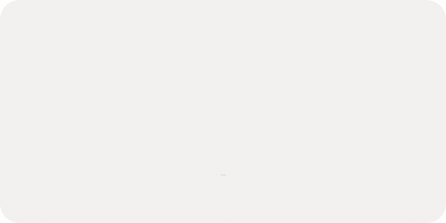
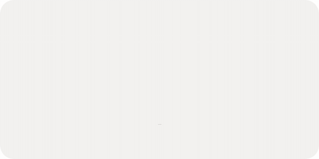
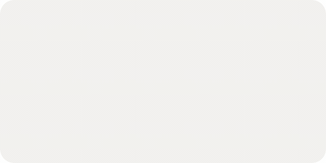
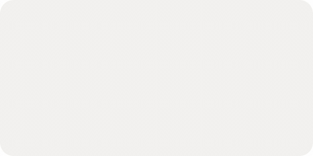
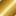
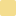
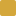
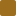

<div align="center">
  <picture>
    <source media="(prefers-color-scheme: dark)" srcset="assets/motion/brainx-marca-escuro.gif">
    
  </picture>

  <h1>brainx</h1>

  <p><b>Identidade visual: o infinito cortado, escrito a ouro.</b></p>

  <p>
    
    
    
    
  </p>
</div>

---

O símbolo nasceu para o aeon, um teclado split, e agora assina a **brainx**. A forma não mudou: um
infinito ( ∞ ) cortado por uma diagonal, desenhado sobre a proporção áurea. O que ele promete também
não: continuidade, precisão e acabamento.

Tudo o que se mexe neste README é um filme do studio de motion, renderizado quadro a quadro a partir
do SVG oficial. Nada foi redesenhado.

## O símbolo: dois polos

<div align="center">
  <picture>
    <source media="(prefers-color-scheme: dark)" srcset="assets/motion/brainx-simetria-escuro.gif">
    
  </picture>
</div>

A marca é feita de **dois ganchos**, cada um com um círculo e uma cauda reta. O segundo é o primeiro
girado 180° em torno do centro, com a cauda mais longa: é ela que atravessa o desenho e corta o
infinito. O eixo vertical marca o corte.

- **Infinito cortado:** dois polos separados que, juntos, fecham um ciclo contínuo.
- **Simetria:** cada metade é a outra virada ao contrário. Nada sobra de um lado.
- **Minimalismo:** dois traços e um eixo. Nada está em excesso, tudo é preciso.

## Construção

<div align="center">
  <picture>
    <source media="(prefers-color-scheme: dark)" srcset="assets/motion/brainx-construcao-escuro.gif">
    
  </picture>
</div>

O desenho parte de poucas guias, todas tiradas do SVG oficial (quadro de 700):

| Guia | Medida |
|---|---|
| Diagonal da marca | 45°, passando pelo centro (350, 349,5) |
| Círculos | raio 125 no eixo do traço, centros a ±85 do centro na diagonal |
| Traço | espessura 30 (bordas nos raios 110 e 140) |
| Caudas | retas tangentes, a ±40 da diagonal |
| Eixo do split | vertical, barras de 15 × 45 acima e abaixo da marca |

As proporções seguem a proporção áurea (Golden Ratio), o que dá à forma uma sensação de ordem que se
percebe antes de se explicar. A prancha estática da construção está em
[`logo/render/png/logo_aeon_goldingratio.png`](logo/render/png/logo_aeon_goldingratio.png).

## Cores

<div align="center">
  <picture>
    <source media="(prefers-color-scheme: dark)" srcset="assets/motion/brainx-paleta-escuro.gif">
    
  </picture>
</div>

O dourado da brainx é **metal, não uma cor chapada**. Ele vive como um gradiente de sombra a brilho a
sombra, em faixas diagonais, e as três cores de ouro da paleta são paradas desse mesmo gradiente.
Quando der para usar o gradiente (tela, impressão com hot stamping, vídeo), use. Quando não der, use os
chapados.

| | Cor | Hex | Papel |
|---|---|---|---|
|  | **Ouro brainx** | gradiente abaixo | a marca em destaque, peças de luxo, motion |
|  | **Ouro Polido** | `#F4DD8E` | brilho, reflexo, detalhe sobre fundo escuro |
|  | **Ouro** | `#D4A73B` | o ouro chapado padrão |
|  | **Ouro Velho** | `#9C6E1E` | ouro legível sobre fundo claro, sombra do metal |
|  | **Preto Profundo** | `#0D0D0D` | fundo escuro, traço no claro |
|  | **Branco Puro** | `#FFFFFF` | traço no escuro |
|  | **Branco Quente** | `#F2F1EF` | fundo claro, com mais calor que o branco puro |

O gradiente, para copiar:

```css
/* fundo escuro */
--ouro-brainx: linear-gradient(135deg,
  #5E3F0F 0%, #9C6E1E 20%, #D4A73B 38%, #F4DD8E 48%,
  #FFF4CF 52%, #E2B84E 60%, #A57A26 80%, #6B4913 100%);

/* fundo claro: mais fechado, para o brilho não sumir no Branco Quente */
--ouro-brainx-claro: linear-gradient(135deg,
  #664510 0%, #966A1C 20%, #C4962F 38%, #E3C470 48%,
  #EED48A 52%, #CFA03A 60%, #9A7022 80%, #634310 100%);
```

Para o metal parecer metal em movimento, desloque o gradiente ao longo da diagonal (com `reflect`)
em vez de mudar as cores: é o brilho que anda, o ouro fica.

## Tipografia

- **Principal: Adrianna DemiBold.** Formas clássicas com toque contemporâneo, curvas refinadas e peso
  equilibrado. Títulos, logotipo e chamadas.
- **Secundária: Cormorant Garamond.** Serifada, para textos descritivos, conteúdo institucional e
  leitura longa (é a que aparece nos nomes da paleta acima).

## Arquivos

| Caminho | O que é |
|---|---|
| `logo/logo_aeon.ai`, `logo/logo_aeon_goldenratio.ai` | fontes editáveis (Illustrator) |
| `logo/render/svg/logo_aeon_whitemode.svg` | símbolo preto, para fundo claro |
| `logo/render/svg/logo_aeon_darkmode.svg` | símbolo branco, para fundo escuro |
| `logo/render/png/` | renders do símbolo e da prancha da construção |
| `assets/motion/` | os GIFs deste README, um par claro/escuro por filme |
| `assets/*.svg` | amostras de cor da tabela |

> Os arquivos ainda levam o nome `aeon` e os logotipos com nome (`logo_type_aeon`, `*_logo_type_aeon.png`)
> escrevem "AEON". O símbolo vale para a brainx; o logotipo com nome ainda precisa ser refeito.

## Motion

Os GIFs saem do studio (`~/programing/kromos-group/studio/films/brainx-*`). Cada filme é uma função
pura do tempo sobre o SVG oficial; a versão `-escuro` só troca o `tema.js`. O ouro e a geometria são
comuns a todos (`films/brainx-comum/`).

| Filme | Duração | Mostra |
|---|---|---|
| `brainx-marca` | 6,3 s | a caneta escreve o símbolo a ouro, o metal enche e brilha |
| `brainx-simetria` | 8,0 s | os dois ganchos e a rotação de 180° |
| `brainx-construcao` | 7,6 s | as guias geométricas e a marca sobre elas |
| `brainx-paleta` | 7,4 s | as seis cores e os três ouros virando um metal só |

Para refazer, no studio:

```sh
for f in marca simetria construcao paleta; do
  node render.mjs films/brainx-$f && node render.mjs films/brainx-$f-escuro
done
sh films/brainx-comum/gif.sh ~/programing/brainx/branding/assets/motion
```

GIF não tem alfa parcial, então o canto arredondado é pintado com o fundo do GitHub de cada tema
(`#FFFFFF` no claro, `#0D1117` no escuro). Fora do GitHub o canto aparece nessa cor.
